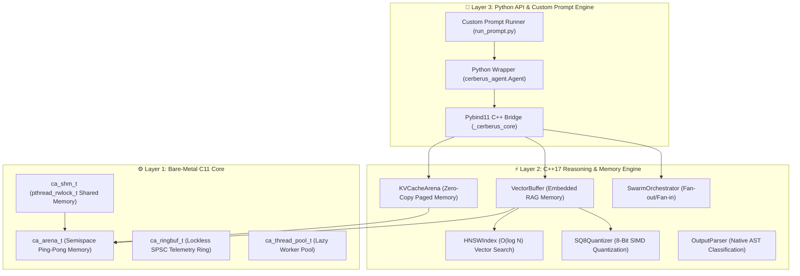
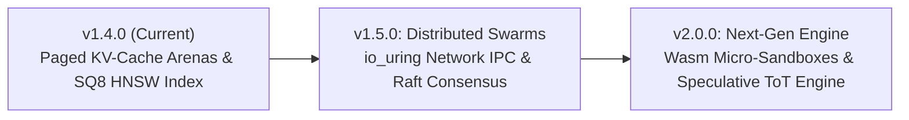

# ⚡ Cerberus Technical Manual & Architectural Blueprint

> **High-Performance Bare-Metal AI Agent Engine (C11 / C++17 / Pybind11 / Python)**  
> **Document Version:** 1.4.0 | **Status:** Active Release

---

## 📌 Executive Summary & Core Philosophy

**Cerberus** is an ultra-low latency, production-grade AI agent runtime engineered from first principles in compiled **C11 and C++17**.

Traditional Python-only agent frameworks (LangChain, AutoGen, CrewAI) suffer from heavy RAM bloat (300 MB – 800 MB+ RSS per agent), high garbage collection pauses, and Global Interpreter Lock (GIL) contention during multi-agent scaling. 

Cerberus solves this bottleneck by shifting the core agent state machine (`Think ➔ Plan ➔ Act ➔ Reflect`), prompt serialization, memory arena management, and vector similarity search into a **bare-metal C/C++ engine**. 

### Key System Metrics
* **State Iteration Speed:** **270,000+ state iterations/second**
* **Memory Footprint:** **~14 MB RSS RAM**
* **Vector RAG Latency:** **$< 0.5\text{ ms}$** via HNSW graph & SIMD AVX2/NEON quantization
* **Execution Safety:** Zero heap allocations after startup via bump-pointer memory arenas

---

## 🏗️ 3-Layer System Architecture



---

## 🧬 Low-Level Data Structures & Memory Layouts

### 1. `ca_arena_t` (Bump-Pointer Memory Arena Header)
Cache-line aligned (64-byte) header to prevent CPU cache false sharing during thread access:

```c
typedef struct CA_CACHE_ALIGN {
    uint8_t*  base;        /* 32-byte aligned base pointer */
    size_t    capacity;    /* Total size allocated at creation */
    size_t    offset;      /* Current bump-pointer offset (O(1) allocation) */
    size_t    peak;        /* High-water mark tracking across resets */
    uint32_t  alloc_count; /* Total active allocation count */
} ca_arena_t;
```

### 2. `PageBlock` & `KVCacheArena` (Zero-Copy Paged KV Memory)
4KB page-aligned shared memory structures for LLM system prompt attention sharing:

```cpp
struct PageBlock {
    uint32_t              block_id;
    size_t                page_count;   /* Number of 4KB pages allocated */
    size_t                size_bytes;   /* page_count * 4096 */
    uint8_t*              data_ptr;     /* mmap shared memory pointer */
    std::string           shm_name;     /* POSIX shm name (e.g. "/cerberus_kv_1") */
    uint64_t              prefix_hash;  /* 64-bit FNV-1a token hash */
    std::atomic<uint32_t> ref_count{1}; /* Atomic reference count */
};
```

### 3. `SQ8Vector` (8-Bit Scalar Vector Quantization)
```cpp
struct SQ8Vector {
    std::vector<uint8_t> codes;    /* Quantized int8/uint8 embeddings (dim bytes) */
    float                min_val;  /* Per-vector min float offset */
    float                scale;    /* Per-vector float scale factor */
};
```

---

## 🔄 Semispace Arena Compaction & Ping-Pong Swap

`ContextBuffer` maintains two equal-sized arenas (`retained_` and `standby_`):
1. **Normal Path**: New messages bump-allocate into `retained_`.
2. **75% Capacity Threshold**: When `retained_` is 75% full, `compact()` is triggered.
3. **Compaction**: Live messages are copied into `standby_`, rewriting string pointers.
4. **Swap & Reset**: `std::swap(retained_, standby_)` is called, and the old arena is reset in $O(1)$ time.

---

## 🗺️ Project Evolution & Release Phases

### 📍 Phase 1: Bare-Metal Core Foundation (v1.0.0 – v1.2.0)
* **v1.0.0 (Core Engine):** Implemented bare-metal C11 bump-pointer memory arena (`ca_arena_t`), C++ execution loop, and Pybind11 Python bindings.
* **v1.1.0 (Memory Compaction):** Semispace ping-pong garbage collection (`retained_` & `standby_` arenas) inside `ContextBuffer` to prevent out-of-memory errors. Zero-copy `memoryview` transfers to Python.
* **v1.2.0 (Dynamic Capability Expansion):** Microsecond C++ AST output classifier (`OutputParser`), dynamic MCP tool hot-swapping (`DynamicToolRegistry`), and POSIX multi-reader single-writer shared memory (`ca_shm_t` with `pthread_rwlock_t`).

### 📍 Phase 2: Swarm Systems & SIMD RAG (v1.3.0)
* **Hierarchical C++ Swarm Orchestration (`SwarmOrchestrator`):** Multi-threaded parallel worker delegation executed on native C thread pools with zero Python GIL contention.
* **Embedded SIMD Vector RAG (`VectorBuffer`):** Hardware AVX2/NEON vector dot-product similarity search for zero-dependency local document retrieval.
* **Lockless Ring Buffer Telemetry (`ca_ringbuf_t`):** Single-producer single-consumer (SPSC) atomic ring buffer for microsecond span tracing and OpenTelemetry (OTLP) exporting.

### 📍 Phase 3: Model & Memory Co-Design (v1.4.0 — Current Release)
* **Zero-Copy Paged KV-Cache Arenas (`KVCacheArena`):** Page-aligned memory backing (`mmap` / POSIX `shm_open`) with 64-bit FNV-1a token sequence hash tables for **0-ms system prompt prefix caching**.
* **SQ8 Vector Quantization (`SQ8Quantizer`):** Compresses 32-bit float vector embeddings into 8-bit `uint8` codes for **4x RAM reduction** with integer SIMD math.
* **Native C++ HNSW Graph Indexing (`HNSWIndex`):** Logarithmic time $O(\log N)$ approximate nearest neighbor search over large embedding corpora.

---

## 🔮 Future Roadmap (v1.5.0 – v2.0.0)



### 📍 Phase 4: Distributed Swarms & Kernel-Bypassing IPC (v1.5.0 — Upcoming)
* **`io_uring` Kernel-Bypassing IPC:** High-throughput, sub-microsecond cross-node agent communication using Linux `io_uring`.
* **Raft Swarm Consensus:** Embedded C++ Raft protocol for swarm state synchronization and instant differential memory arena snapshot replay.

### 📍 Phase 5: Secure Execution & Speculative Engine (v2.0.0)
* **Wasm Micro-Sandboxing (`ca_wasm_t`):** Embedded WebAssembly runtime (Wasmtime / Wasmer C API) inside `ca_exec_t` for secure, zero-fork tool execution.
* **Speculative Tree-of-Thought (ToT) Engine:** Multi-threaded parallel reasoning path evaluation where losing branch memory arenas are instantly reclaimed via $O(1)$ semispace resets.

---

## 💡 Operational Modes: With LLM vs. Without LLM

| Dimension | ⚡ Cerberus WITHOUT LLM | 🧠 Cerberus WITH LLM |
| :--- | :--- | :--- |
| **Brain / Planner** | **C++ Pattern & Regex Classifier** (`OutputParser`) | **Local / Cloud LLM** (Ollama, Qwen, Llama 3) |
| **Step Speed** | **$< 0.01\text{ ms}$ (270,000+ iter/sec)** | **~15 – 50 ms / step** |
| **RAM Requirement** | **~14 MB RAM** | **~14 MB + Model Size (~400MB - 2GB)** |
| **Task Type** | Deterministic tool execution, fixed rules, SIMD vector RAG search | Unstructured natural language prompts, code writing, self-correction |

---

## 📖 C++ & Python API Reference

### 1. `KVCacheArena` API
```python
from cerberus_agent import KVCacheArena

# Initialize page arena with 1024 pages (4MB)
kv = KVCacheArena(capacity_pages=1024, shm_prefix="/cerberus_kv_")

# Allocate or lookup paged KV memory block
block = kv.allocate_block(token_prefix="<system>Prompt</system>", min_bytes=4096)
print(f"Block ID: {block.block_id}, Pages: {block.page_count}, SHM Name: {block.shm_name}")

# Release reference when done
kv.release_block(block.block_id)
```

### 2. `VectorBuffer` with SQ8 & HNSW API
```python
from cerberus_agent import VectorBuffer

vb = VectorBuffer(dim=512)
vb.enable_sq8(True)                          # Enable 4x SQ8 compression
vb.build_hnsw_index(M=16, ef_construction=64) # Build logarithmic O(log N) index

# Push vector and query
idx = vb.push(embedding=[0.1]*512, text="Doc Chunk 1")
matches = vb.query(embedding=[0.1]*512, top_k=5)
```

---

## 🎯 Detailed Real-World Applications

1. **Embedded Linux & Edge AI Systems (IoT, Drones, Robotics)**
   - Operates on resource-constrained single-board computers (Raspberry Pi 4/5, NVIDIA Jetson) at **~14 MB RAM** where traditional Python frameworks crash.
   - Executes real-time sensor monitoring, motor control commands, and local offline decision-making.

2. **Autonomous Software Engineering & Repository Maintenance**
   - High-speed code scanning, AST parsing, automated refactoring, unit test execution, and git workflow management.

3. **High-Throughput Multi-Agent Swarm Processing**
   - Parallel worker delegation (`SwarmOrchestrator`) across multi-core processors for concurrent data scraping, document analysis, and research tasks without GIL locks.

4. **Zero-Dependency Private Local Knowledge RAG**
   - Offline document indexing and sub-millisecond similarity search using embedded C++ HNSW and SQ8 SIMD quantization without sending sensitive data to external cloud vector databases.

---

## 📄 License

Cerberus is released under the **MIT License**.
